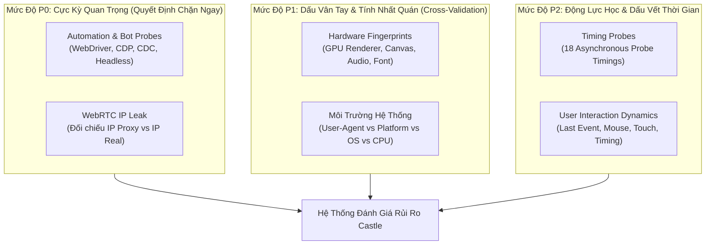

# Báo Cáo Phân Tích Kỹ Thuật: Cấu Trúc & Các Trường Quan Trọng Trong Castle Anti-Bot Token (Twitter/X)

---

## 1. Tổng Quan Kiến Trúc Castle Token

Castle là hệ thống telemetry & anti-bot được Twitter/X sử dụng để thu thập thông tin thiết bị, cấu hình trình duyệt, môi trường thực thi và kiểm tra các dấu hiệu tự động hóa (headless/automation tools).

Hệ thống token đã trải qua 4 phiên bản chính:
- **V1 (`uq1seNrd`)**: 749 metrics, sử dụng mã hóa chuỗi `Pn()`, `Mn()`, mã hóa số nguyên `On()`, float `Fd()`, stream cipher FNV-1a (offset `0xBC0D78D5`) + Xorshift32.
- **V2 (`cNz8rPYH`)**: 768 metrics, bổ sung bộ mã hóa chuỗi `lr()` (ROL1 + ADD 0xC481 + ROL2 -> Base64), bộ tính timing Float32 `kd()`, stream cipher FNV-1a (offset `0x751DAC79`).
- **V3 (`WcmFKZlD`)**: 772 metrics, nâng cấp bộ mã hóa chuỗi `Gn()` / `Kn()`, mã hóa timing Float32 `Qd()`, stream cipher FNV-1a (offset `0x4A391620`).
- **V4 (`EZK-f_Qb`)**: 776 metrics (bundle mới nhất từ `abs-twimg-assets` Cw-9YlpW.js), nâng cấp bộ mã hóa chuỗi `nr()` (XOR 0x2042 + ADD 0x486D + ROR5 -> Base64), bộ mã hóa timing Float32 `Wd()` (ROL1 + ADD 118 + ROL5 -> Base64), stream cipher FNV-1a (offset `0xA72E5B0C`) + Xorshift32. Các timing probe dịch chuyển vị trí từ 687..771 sang 691..775 (+4 vị trí).

### Cấu Trúc Đóng Gói Nhị Phân (Binary Protocol Wire Format)
```
[ Key Length (LEB128/Varint) ]
[ Encrypted Timestamp Key (Base64) ]
[ Security Header (24 Bytes) ] -> (seg1: 4B, seg2: 4B, checksum: 16B)
[ Encrypted Stream (Zlib Raw Deflate) ]
     └── LEB128 Total Items
     └── [ Type Tag (0..10) + Item Value ] x N metrics
```

---

## 2. Phân Loại & Đánh Giá Các Trường / Chỉ Số Quan Trọng Nhất

Hơn 700 chỉ số telemetry được chia thành các nhóm có mức độ ảnh hưởng quyết định đến điểm rủi ro (Risk Score) của phía máy chủ:



---

### Nhóm 1: Phát Hiện Tự Động Hóa & Bot Framework (Mức Độ P0 - High Risk)

Nếu bất kỳ cờ nào trong nhóm này bị kích hoạt, token sẽ bị đánh dấu là bot bất kể các thông số phần cứng khác có hoàn hảo hay không:

| Chỉ số / Metric Name | V1 Index | V2 Index | V3 Index | Cơ Chế & Ý Nghĩa Kỹ Thuật |
| :--- | :---: | :---: | :---: | :--- |
| `webdriver_active` / `webdriver_flag` | 22 | 383 | 43 | Kiểm tra cờ `navigator.webdriver`. Luôn phải trả về `false`/không kích hoạt. |
| `automation_flags (1..8)` | 44 | - | 68, 92, 176, 228, 244, 416, 527, 535 | 8 kiểm tra tự động hóa mở rộng được nhúng rải rác trong client. |
| `cdp_code` / `cdp_protocol_active` | 383 | 383 | 445 | Phát hiện sự hiện diện của **Chrome DevTools Protocol (CDP)**. Ở trạng thái duyệt web tự nhiên, trường này phải trả về `'N'` (Clean/Sạch). |
| `headless_browser` / `headless_flag` | 143 | 395, 396 | 355 | Phát hiện trình duyệt chạy ngầm không có cửa sổ hiển thị (Headless Chrome, xvfb giả lập không hoàn chỉnh). |
| `selenium_cdc_flag` | - | - | 506 | Quét các biến đặc trưng do ChromeDriver cấy vào cửa sổ JavaScript (`window.document.$cdc_asdjflasutopfhvcZLmcfl_`). |
| `proto_probe` & `stack_probe` | - | 579, 619 | 558, 597 | Quét kiểm tra **Prototype Pollution** (`__proto__`) và độ sâu call stack để phát hiện các đoạn script hooking/monkey-patching của extension hoặc bot. |

---

### Nhóm 2: Mạng & Rò Rỉ IP Thực (Mức Độ P0 - Network Consistency)

| Chỉ số / Metric Name | V1 Index | V2 Index | V3 Index | Cơ Chế & Ý Nghĩa Kỹ Thuật |
| :--- | :---: | :---: | :---: | :--- |
| `client_ip` / `client_ip_address` | 406 | 473 | 212 | **Địa chỉ IP thực sự** của máy khách được thu thập qua kỹ thuật **WebRTC STUN/ICE Candidate**.<br/>*(Được mã hóa qua `lr()` trên V2 hoặc `Gn()` trên V3)*. |
| `origin_url` / `site_domain` | - | 260, 520 | 157, 598 | Tên miền và URL gốc phát sinh token. Ngăn chặn việc tạo token ở một domain khác rồi replay sang Twitter. |

> [!CRITICAL]
> **Điểm rò rỉ WebRTC IP:** Nếu sử dụng proxy HTTP nhưng không vô hiệu hóa hoặc không can thiệp WebRTC, địa chỉ IP ISP thực sẽ được gửi trực tiếp trong metric này. Khi máy chủ Castle đối chiếu IP gói tin HTTP và IP trong metric này, sự bất đồng bộ sẽ lập tức dẫn đến cảnh báo bảo mật.

---

### Nhóm 3: Dấu Vân Tay Phần Cứng Độc Nhất (Mức Độ P1 - Hardware Fingerprinting)

Các trường này giúp hệ thống nhận diện chính xác từng thiết bị cụ thể (Device ID / Machine ID):

| Chỉ số / Metric Name | V1 Index | V2 Index | V3 Index | Cơ Chế & Ý Nghĩa Kỹ Thuật |
| :--- | :---: | :---: | :---: | :--- |
| `canvas_2d_hash` / `canvas_fp` | 6 | 6, 135 | 10 | Hash kết quả render canvas 2D ẩn (phụ thuộc vào thuật toán khử răng cưa và GPU). |
| `gpu_renderer` / `gpu_vendor` | 11, 86 | 60, 332 | 237, 573 | Tên hãng và card đồ họa WebGL (ví dụ: `ANGLE (NVIDIA, NVIDIA GeForce RTX 3060...)`). Nếu xuất hiện `SwiftShader` hoặc `llvmpipe` (GPU phần mềm ảo hóa) $\rightarrow$ bị đánh bot. |
| `audio_oscillator_hash` / `audio_fp` | 8 | 143 | 179 | Dấu vân tay AudioContext (xử lý xung nhịp tín hiệu sóng âm DSP). |
| `device_uuid` / `hw_fp` | 163 | 12, 668 | 160 | Mã định danh thiết bị duy nhất được tính từ tổng hòa các thông số phần cứng. |
| `font_probe_*` | 683..764 | 683..764 | 687..768 | Mảng kiểm tra **82 font chữ hệ thống**. Trạng thái font cài đặt giúp phân biệt chính xác hệ điều hành máy khách (Windows, macOS, Ubuntu, v.v.). |

---

### Nhóm 4: Tính Nhất Quán Giữa Các Trường Môi Trường (Mức Độ P1 - Cross-Metric Consistency)

Castle thực hiện kiểm tra chéo (Cross-validation) giữa các thông số với nhau:

1. **User-Agent & Client Hints**:
   - `user_agent` (V2: `[63]`, V3: `[96]`)
   - `ua_brands` (V2: `[215]`, V3: `[523]`)
   - `browser_version` & `engine_version` (V2: `[28, 248]`, V3: `[57, 670]`)
2. **Hệ Điều Hành & Nền Tảng**:
   - `os_name`, `platform`, `arch_bits` (V2: `[8, 11, 366]`, V3: `[21, 87, 125, 402]`)
   - *Quy tắc:* Nếu User-Agent là `Windows NT 10.0` nhưng `platform` trả về `Linux x86_64` $\rightarrow$ Phát hiện giả lập thất bại.
3. **Màn Hình & Độ Phân Giải**:
   - `screen_width`, `screen_height`, `pixel_ratio`, `color_depth`
   - Kích thước cửa sổ nội bộ (`innerWidth`, `innerHeight` - V3: `[22, 258]`). Nếu kích thước rơi vào tỉ lệ mặc định của các tool tự động (như $800 \times 600$) sẽ bị nghi ngờ.
4. **Tài Nguyên Phần Cứng**:
   - `hw_concurrency` (Số nhân CPU vật lý - V2: `[75]`, V3: `[85]`)
   - `device_memory` (Dung lượng RAM GB - V3: `[668]`)

---

### Nhóm 5: Động Lực Học Thời Gian & Hành Vi (Mức Độ P2 - Dynamics & Timings)

| Chỉ số / Metric Name | V2 Index | V3 Index | Cơ Chế & Ý Nghĩa Kỹ Thuật |
| :--- | :---: | :---: | :--- |
| `probe_time_sync_total` | 747 | 751 | Tổng thời gian thực thi các bài test đồng bộ (ms). |
| `probe_time_total_token` | 748 | 752 | Tổng thời gian hoàn thành toàn bộ token (ms). |
| `probe_time_async_0` .. `17` | 750..767 | 754..771 | **18 probe bất đồng bộ**: đo độ trễ khởi tạo WebGL, Worker Debugger, AudioContext, Battery API, rAF (`requestAnimationFrame`). |
| `last_event` & `event_timing` | 341, 343 | 555 | Sự kiện tương tác chuột/bàn phím gần nhất trước khi sinh token. |

> [!NOTE]
> **Hardware Jitter:** Các probe timing được mã hóa dưới dạng `Float32` thông qua `kd()` (trên V2) hoặc `Qd()` (trên V3). Các môi trường bot mô phỏng bằng code chay thường có độ trễ bằng 0 hoặc các giá trị số nguyên tròn trịa, trong khi phần cứng thật luôn có độ trễ dao động (jitter) từ $0.1$ đến hàng chục mili-giây.

---

## 3. Bảng Tổng Hợp Tiêu Chí Kiểm Soát Chất Lượng Token

| Mức Độ Ưu Tiên | Nhóm Chỉ Số | Yêu Cầu Kỹ Thuật Cốt Lõi |
| :--- | :--- | :--- |
| **P0 (Critical)** | Detection Flags | `webdriver_flag === false`, `cdp_code === 'N'`, không có dấu hiệu `selenium_cdc`. |
| **P0 (Critical)** | IP & WebRTC | IP WebRTC (`client_ip`) phải khớp hoàn toàn với Outgoing IP của Proxy. |
| **P1 (High)** | Hardware Realism | Không được để lọt GPU Driver ảo (`Mesa`, `SwiftShader`). Canvas & Audio hash hợp lệ. |
| **P1 (High)** | Consistency | Đồng bộ 100% giữa OS, CPU Arch, User-Agent, Platform và Client Hints. |
| **P2 (Medium)** | Timing Jitter | 18 probe async timing phải có độ trễ vi phân ngẫu nhiên mô phỏng phần cứng thực tế. |
| **P2 (Medium)** | User Events | Phải ghi nhận ít nhất một tương tác giao diện thực (`pointermove`, `keydown`, `focus`). |
