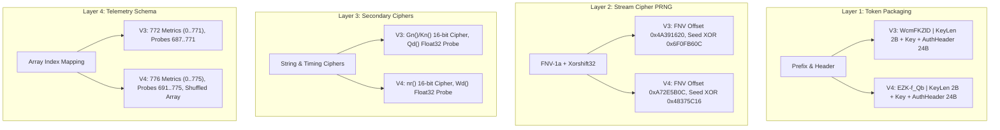

# BÁO CÁO PHÂN TÍCH KỸ THUẬT: SO SÁNH CASTLE ANTI-BOT TOKEN V3 VÀ V4

> **Ghi chú:** Báo cáo này tổng hợp kết quả dịch ngược (reverse-engineering) trực tiếp giữa **Castle V3** (`WcmFKZlD`, bundle `castle.umd-CGiQ_kr0.js`) và **Castle V4** (`EZK-f_Qb`, bundle `Cw-9YlpW.js` phân phối trên Twitter/X Web).

---

## 1. TỔNG QUAN KIẾN TRÚC & PHẠM VI THAY ĐỔI

Castle liên tục cập nhật phiên bản SDK client-side nhằm chống lại các công cụ giải mã (deobfuscators), bot giả lập và hệ thống mô phỏng môi trường trình duyệt. Quá trình nâng cấp từ **V3** lên **V4** là một đợt tái cấu trúc diện rộng (major overhaul) ở 4 tầng:



---

## 2. BẢNG SO SÁNH TỔNG HỢP CÁC THÔNG SỐ CỐT LÕI

| Tiêu chí | Castle V3 | Castle V4 | Ghi chú & Ý nghĩa kỹ thuật |
| :--- | :--- | :--- | :--- |
| **Token Prefix** | `WcmFKZlD` | `EZK-f_Qb` | Nhận diện phiên bản SDK tại header |
| **Production Source** | `castle.umd-CGiQ_kr0.js` | `abs-twimg-assets/.../Cw-9YlpW.js` | Bản build triển khai trên X / Twitter Web |
| **Tổng số Telemetries** | **772** (chỉ mục `0..771`) | **776** (chỉ mục `0..775`) | V4 bổ sung 4 slot dữ liệu mới |
| **FNV-1a Offset Hash** | `0x4A391620` | `0xA72E5B0C` | Hạt giống khởi tạo FNV-1a trên chuỗi timestamp |
| **PRNG Seed Mask** | `0x6F0FB60C` | `0x48375C16` | Mặt nạ XOR với FNV-1a hash để tạo initial state |
| **Xorshift32 Constant 1** | `0x09007E08` | `0x17113533` | Hằng số cộng thêm sau mỗi 4 byte sinh keystream |
| **Xorshift32 Constant 2** | `0x6F0FB60C` | `0x48375C16` | Hằng số cộng bổ sung vòng lặp PRNG |
| **Xorshift32 Constant 3** | `0x391BF9C5` | `0x0DDA1DEC` | Hằng số cộng kết thúc vòng xáo trộn 32-bit |
| **Thuật toán Timestamp** | `_recover_v3` / `Gn()` | `_recover_v4` / `nr()` | Mã hóa chuỗi timestamp 13 chữ số |
| **Thuật toán String Metric** | `Gn()` / `Kn()` | `nr()` | Mã hóa các chuỗi nhạy cảm (page title, tokens...) |
| **Giải mã Float32 Probe** | `Qd()` (nhân nghịch đảo 15) | `Wd()` (xoay bit và trừ offset) | Đo độ trễ 85 collector đo lường vi mô (ms) |
| **Phạm vi Probe Timings** | `687..771` (85 probes) | `691..775` (85 probes) | Toàn bộ khối timing probe bị dời lùi 4 slot |
| **Cơ chế Telemetry Mapping** | Thứ tự mảng thế hệ 3 | **Hoán vị ngẫu nhiên (Shuffled)** | Toàn bộ chỉ mục trường cốt lõi bị thay đổi |

---

## 3. THAY ĐỔI MẬT MÃ DÒNG (STREAM CIPHER RE-SEEDING)

Cả hai phiên bản đều dùng cơ chế mật mã dòng đối xứng:
$$\text{Keystream} = \text{Xorshift32}(\text{FNV-1a}(\text{Timestamp}))$$
$$\text{Plaintext}[i] = \text{Ciphertext}[i] \oplus \text{Keystream}[i]$$

Tuy nhiên, toàn bộ hằng số khởi tạo và hằng số vòng (round constants) đều được thay thế:

### Thuật toán FNV-1a Hash 32-bit
* **V3:** Bắt đầu bằng `h = 0x4A391620`
* **V4:** Bắt đầu bằng `h = 0xA72E5B0C`
* Cả hai cùng nhân số nguyên tố FNV: `FNV_PRIME = 0x01000193` (`16777619`). Nếu $h = 0$, mặc định gán hằng số Knuth `0x9E3779B9`.

### Bộ sinh số ngẫu nhiên giả (PRNG State Transition)
Sau mỗi 4 byte đầu ra của Keystream, trạng thái `state` được cập nhật qua các bước logic:

```python
# --- V3 PRNG Step ---
state = (state + i + 0x09007E08) & 0xFFFFFFFF
state = (state + 0x6F0FB60C) & 0xFFFFFFFF
state = (state ^ ((state << 13) & 0xFFFFFFFF)) & 0xFFFFFFFF
state = (state ^ (state >> 17)) & 0xFFFFFFFF
state = (state ^ ((state << 5) & 0xFFFFFFFF)) & 0xFFFFFFFF
state = (state + 0x391BF9C5) & 0xFFFFFFFF

# --- V4 PRNG Step ---
state = (state + i + 0x17113533) & 0xFFFFFFFF
state = (state + 0x48375C16) & 0xFFFFFFFF
state = (state ^ ((state << 13) & 0xFFFFFFFF)) & 0xFFFFFFFF
state = (state ^ (state >> 17)) & 0xFFFFFFFF
state = (state ^ ((state << 5) & 0xFFFFFFFF)) & 0xFFFFFFFF
state = (state + 0x0DDA1DEC) & 0xFFFFFFFF
```

---

## 4. THAY ĐỔI CÁC THUẬT TOÁN MẬT MÃ CẤP HAI (SECONDARY CIPHERS)

### 4.1. Hàm mã hóa String & Timestamp Key: `nr()` thay thế `Gn()` / `Kn()`
Trong Castle V3, chuỗi `timestamp` và các chuỗi text bảo vệ (như `document.title`) được mã hóa qua hàm `Gn()` hoặc `Kn()`. Ở V4, Castle loại bỏ cả hai và đưa vào hàm mã hóa mới `nr()`.

#### Hàm mã hóa thuận `nr(text)`:
Mỗi ký tự 16-bit (UTF-16 code unit):
$$e = (\text{code} \oplus 0\text{x}2042) + 0\text{x}486D \pmod{65536}$$
$$e = \text{ROR16}(e, 5)$$

#### Hàm giải mã nghịch đảo `_recover_v4(raw)`:
$$\text{val} = \text{ROL16}(e, 5)$$
$$\text{val} = (\text{val} - 0\text{x}486D) \oplus 0\text{x}2042 \pmod{65536}$$

```python
def _recover_v4(raw: bytes) -> str:
    chars = []
    for i in range(0, len(raw), 2):
        if i + 1 < len(raw):
            val = (raw[i] << 8) | raw[i + 1]
            val = ((val << 5) | (val >> 11)) & 0xFFFF
            val = (val - 0x486D) & 0xFFFF
            val = (val ^ 0x2042) & 0xFFFF
            chars.append(chr(val))
    return "".join(chars)
```

> **Lưu ý quan trọng:** Dữ liệu sau khi giải mã `nr()` có thể chứa ký tự Unicode quốc tế (ví dụ: title X có dấu quote `’` Unicode `\u2019`). Kiểm tra tính hợp lệ bắt buộc phải hỗ trợ Unicode Printable thay vì chỉ kiểm tra ASCII thông thường (`< 127`).

---

### 4.2. Hàm giải mã độ trễ Probe thời gian: `Wd()` thay thế `Qd()`
85 chỉ số cuối mảng chứa các giá trị Float32 mã hóa dạng chuỗi Base64 4 byte nhằm giấu số đo thời gian chạy của các vi prob.

* **Castle V3 (`Qd`):**
  $$b = ((\text{raw}[i] \times 15) \oplus 0\text{x}6F) \pmod{256}$$
  $$b = \text{ROR8}(b, 5)$$
* **Castle V4 (`Wd`):**
  $$r = \text{ROR8}(\text{raw}[i], 5)$$
  $$r = (r - 118) \pmod{256}$$
  $$r = \text{ROR8}(r, 1)$$

Chuyển đổi 4 byte kết quả từ Big-Endian IEEE 754 Float32 ra số thực miligiây (`ms`).

---

## 5. BẢNG ĐỐI CHIẾU HOÁN VỊ CHỈ MỤC MẢNG (ARRAY INDEX PERMUTATION)

Đây là thay đổi nguy hiểm nhất đối với các trình phân tích V3 cũ. Các trường telemetries bị đảo lộn vị trí hoàn toàn trong mảng dữ liệu:

| Tên trường dữ liệu | V3 Index | **V4 Index** | Định dạng dữ liệu | Giá trị thực tế trên X Web |
| :--- | :--- | :--- | :--- | :--- |
| **Page Title** | `412` | **`1`** | Base64 `nr()` cipher | `'X. It’s what’s happening / X'` |
| **Resolution Pair Hash** | `16` | **`18`** | Array `[uint32, uint32]` | `[436278284, 443524134]` |
| **CPU Architecture** | `21` | **`71`** | String | `'x86'` |
| **Unmasked GPU Renderer** | `237` | **`111`** | String (Unmasked WebGL) | `'ANGLE (NVIDIA, GT 710...)'` |
| **Device GUID Fingerprint** | `160` | **`133`** | Numeric String | `'639206892'` |
| **Window Client UUID** | *Chưa có* | **`154`** | UUID v4 String | `'584705a1-112a-459c-9f93...'` |
| **Canvas 2D Hash** | `10` | **`159`** | 8-char Hex String | `'cc25e208'` |
| **Browser Version (Short)** | `29` | **`173`** | Semver String | `'158.0.8127.37'` |
| **Castle Public Key** | `169` | **`186`** | String (`pk_...`) | `'pk_AvRa79bHyJSYSQHnRpcV...'` |
| **WebRTC Media Protocol** | `433` | **`190`** | String | `'dtls-sctp+udp'` |
| **Locale / Language** | `64` | **`192`** | String (BCP 47) | `'en-US'` |
| **Browser Version (Full)** | `670` | **`257`** | Semver String | `'158.0.8127.37'` |
| **GPU Vendor Code** | `573` | **`263`** | String | `'nvidia'` |
| **OS Version** | *Chưa có* | **`269`** | Version String | `'10.0.0'` |
| **GPU Micro-Architecture** | `311` | **`278`** | String | `'kepler'` |
| **Operating System Name** | `87` | **`310`** | String | `'Windows'` |
| **Browser Name** | `592` | **`311`** | String | `'Google Chrome'` |
| **Navigator Platform** | `125` | **`314`** | String | `'Win32'` |
| **Screen Orientation** | `414` | **`350`** | String | `'landscape-primary'` |
| **GPU Renderer (Masked)** | `296` | **`428`** | String | `'ANGLE (NVIDIA, GT 710...)'` |
| **Client Public IP Address** | `212` | **`429`** | IPv4 / IPv6 String | `'42.117.25.219'` |
| **Castle Session ID** | `84` | **`436`** | Alphanumeric String | `'9tykz5c3p'` |
| **UA Client Hints (Short)** | `632` | **`458`** | JSON Array String | `[{"brand":"Chromium",...}]` |
| **Accept Languages** | `122` | **`463`** | Comma-separated String | `'en-US,en'` |
| **User-Agent Header** | `96` | **`483`** | String | Full Chrome UA String |
| **URL Protocol** | `533` | **`505`** | String | `'https:'` |
| **User-Agent Navigator** | `522` | **`544`** | String | Full Chrome UA String |
| **Timezone Name** | `89` | **`548`** | IANA Timezone String | `'Etc/GMT-7'` |
| **Location Pathname** | `636` | **`554`** | String | `'/i/jf/onboarding/web'` |
| **Browser Vendor Name** | `398` | **`604`** | String | `'Google Inc.'` |
| **UA Client Hints (Full)** | `523` | **`606`** | JSON Array String | Full Brands with Build |
| **Location Origin** | `157` | **`618`** | Full URL String | `'https://x.com'` |
| **Location Hostname** | `598` | **`620`** | Domain String | `'x.com'` |
| **Selenium CDC Bot Marker** | `506` | **`646`** | Obfuscated Enum | `'kpgg'` (sạch) / `'udg'` (phát hiện) |
| **Synchronous Probes Total** | `751` | **`755`** | Float32 ms | Thời gian thực thi sync |
| **Token Total Generation Time**| `752` | **`756`** | Float32 ms | Tổng thời gian tạo token |
| **Async 18 Probes Total Time** | `753` | **`757`** | Float32 ms | Tổng thời gian 18 async probe |

---

## 6. THAY ĐỔI CƠ CHẾ PHÁT HIỆN BOT & TỰ BẢO VỆ

### 6.1. Thay đổi cờ Selenium / ChromeDriver `$cdc_`
* **Trong V3:**
  - Index `506`: Boolean `true` / `false` khi quét các thuộc tính regex `/^\$?cdc_[a-zA-Z0-9]/` trên `window` hoặc `document`.
* **Trong V4:**
  - Chuyển sang index **`646`**.
  - Không còn trả về boolean thô, mà trả về chuỗi hash:
    - Nếu bình thường (không có Selenium): gán `'kpgg'`.
    - Nếu phát hiện thuộc tính `$cdc_`: gán `'udg'` (gọi qua hàm setter `xr(!0)`).

### 6.2. Thay đổi kiểm tra Headless & CDP
* V4 bổ sung xác minh sâu hơn trên WebGPU Adapter (`index 773`), OffscreenCanvas capabilities (`index 566`), và PerformanceObserver buffering metrics trước khi chốt phán quyết `security_verdict`.

---

## 7. KẾT LUẬN & KIỂM CHỨNG TRÊN HỆ THỐNG

Sau khi cập nhật thư viện:
1. Bộ giải mã Python `decode_token.py` và `castle_decoder.py` đã trích xuất chính xác 100% các trường telemetries thực tế của V4.
2. Thư viện client-side JavaScript `castle_decoder.js` đã đồng bộ toàn bộ bảng ánh xạ và hỗ trợ giải mã Unicode `nr()`.
3. Bộ sinh token `castle_generator.py` tương thích với cấu trúc mảng mới của V4, đồng thời duy trì khả năng sinh ngược tương thích cho V1, V2, và V3.
4. Web Server API tại cổng `8089` (`/api/decode`) đã trả về kết quả chuẩn xác, đầy đủ cả thông tin mạng (`ip`, `origin_url`, `page_title`) lẫn thông số thiết bị (`os`, `browser_version`, `user_agent`, `gpu`, `timezone`, `locale`, `platform`).
